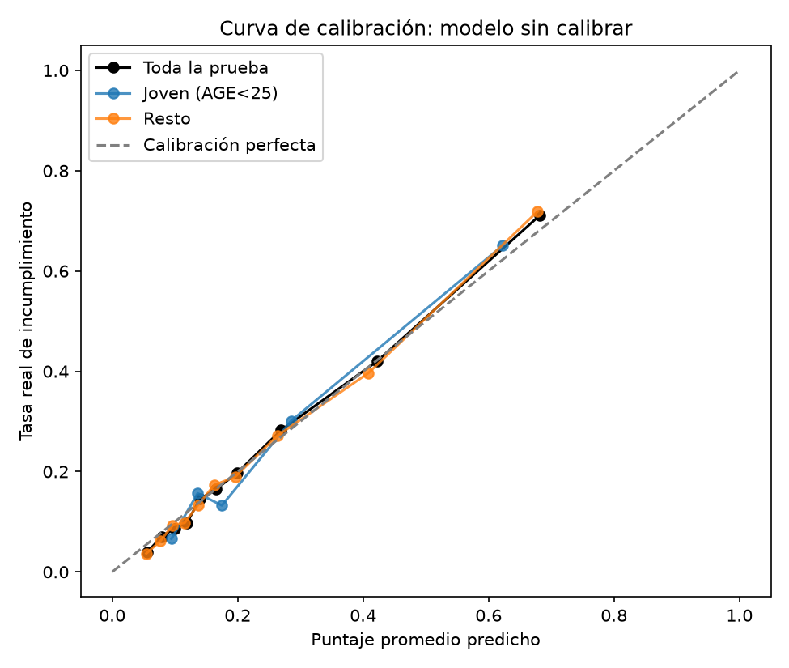
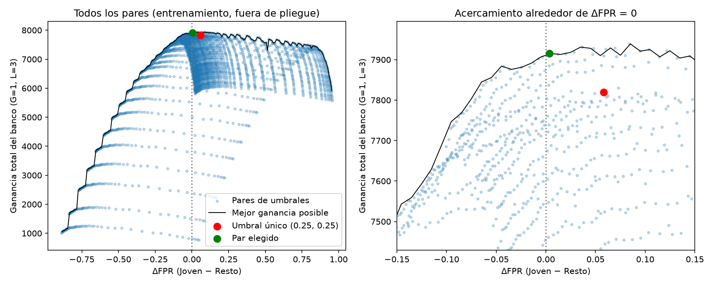

# Problema 1. Equidad imposible

- **Datos:** Default of Credit Card Clients (UCI), 30,000 clientes de un banco de Taiwán en 2005.
- **Grupos:** como a mod 3 = 2, comparo a los menores de 25 años contra el resto.
- **Umbral:** como b mod 3 = 0, L = 3G y el umbral es G/(G+L) = 0.25.
- **Semilla:** 222214735.

## Cómo reproducir los resultados

Desde esta carpeta, con el entorno del README principal activado:

```bash
jupyter nbconvert --to notebook --execute --inplace problema-1.ipynb
```

La libreta descarga los datos en `data/`, tarda varios minutos y guarda tablas y figuras en `resultados/`.

## Decisiones del modelo

- Los códigos sin documentar de `EDUCATION` (0, 5, 6) y `MARRIAGE` (0) se agrupan en "otros".
- `PAY_*` se trata como categórica.
- `AGE` entra al modelo. El inciso (e) prueba lo contrario.

| Modelo | AUC en validación cruzada | AUC en prueba |
|---|---:|---:|
| Regresión logística (`C=0.1`) | 0.7676 | 0.7706 |
| Boosting (`learning_rate=0.05`, `max_depth=7`, `max_iter=200`) | **0.7785** | **0.7887** |

Elegí el boosting por su AUC de validación cruzada. Su AUC en prueba es casi igual en jóvenes (0.7887) y en el resto (0.7881).

## Calibración

El modelo ya está calibrado dentro de lo que esta prueba permite medir: el puntaje promedio es 0.2625 contra una tasa real de 0.2611 en jóvenes, y 0.2188 contra 0.2172 en el resto.
La calibración isotónica no mejora el Brier de forma distinguible del ruido (IC de la mejora: [-0.00006, 0.00092], que incluye el 0 por muy poco), así que me quedo sin ella.



## Umbral único de 0.25

| Grupo | n | p | Rechazo | PPV | FPR | FNR |
|---|---:|---:|---:|---:|---:|---:|
| Joven | 831 | 0.2611 | 0.3177 | 0.5455 | 0.1954 | 0.3364 |
| Resto | 8,169 | 0.2172 | 0.2610 | 0.4934 | 0.1689 | 0.4070 |

La identidad del inciso (a) se cumple hasta el sexto decimal en los dos grupos.

Intervalos de bootstrap del 95 % para la diferencia entre jóvenes y el resto:

| Métrica | Diferencia | IC 95 % | ¿Incluye 0? |
|---|---:|---:|---|
| FPR | 0.0266 | [-0.0062, 0.0591] | Sí |
| FNR | -0.0706 | [-0.1354, -0.0084] | No |
| PPV | 0.0520 | [-0.0101, 0.1193] | Sí |
| Tasa de rechazo | 0.0567 | [0.0227, 0.0880] | No |

Las diferencias de FNR y de rechazo probablemente son reales. La de FPR, que es la métrica que elegí, no se puede distinguir del ruido con esta prueba, aunque los puntajes fuera de pliegue del entrenamiento van en la misma dirección.

## Intervención: igualar la FPR

Elegí los umbrales con puntajes fuera de pliegue del entrenamiento: 0.32 para jóvenes y 0.26 para el resto.

| Grupo | Umbral | Rechazo | PPV | FPR | FNR |
|---|---:|---:|---:|---:|---:|
| Joven | 0.32 | 0.2611 | 0.5806 | 0.1482 | 0.4194 |
| Resto | 0.26 | 0.2481 | 0.5081 | 0.1559 | 0.4194 |

- **Costo:** la ganancia baja de 3,424 a 3,416, es decir 8 unidades (0.23 %). Su IC del 95 % es [-35, 51], así que incluye el 0: en esta prueba el costo no se distingue de cero.
- **A quién le cambia la decisión:** nadie queda rechazado por la intervención. Se acepta a 152 clientes más: 47 jóvenes, de los que no pagó el 38.3 % (ganancia de -25), y 105 del resto, de los que no pagó el 21.0 % (ganancia de +17). El neto es -8.
- **Otras definiciones:** las diferencias de FNR y de rechazo se reducen a 0.0000 y 0.0130, y sus intervalos ya incluyen el 0. La de PPV sube a 0.0725, con IC [0.0050, 0.1439], que ya no incluye el 0.

Esto coincide con la teoría: si las tasas de incumplimiento son distintas, no se pueden igualar a la vez PPV, FPR y FNR.



Cada punto es un par de umbrales. Cerca de ΔFPR = 0 la frontera es casi plana. En entrenamiento el par elegido incluso gana más que el umbral único (7,915 contra 7,820), señal de que la ganancia empírica tiene ruido de ese orden, y por eso el costo de 8 unidades en prueba no debe sobreinterpretarse.

## ¿Basta con quitar la edad?

No. Sin `AGE`, las diferencias siguen ahí: ΔFPR es 0.0247 con IC [-0.0075, 0.0564] (con `AGE` era 0.0266), y ΔFNR es -0.0907. Los intervalos con y sin `AGE` se solapan casi por completo, así que no se puede afirmar que quitarla cambie la equidad en ningún sentido, pero tampoco la corrige.

Hay dos razones. Las tasas de incumplimiento siguen siendo distintas, y otras variables contienen la edad: sin `AGE` se puede distinguir a los jóvenes con AUC de 0.877, sobre todo por `LIMIT_BAL` (AUC individual de 0.812) y `MARRIAGE` (0.685).
