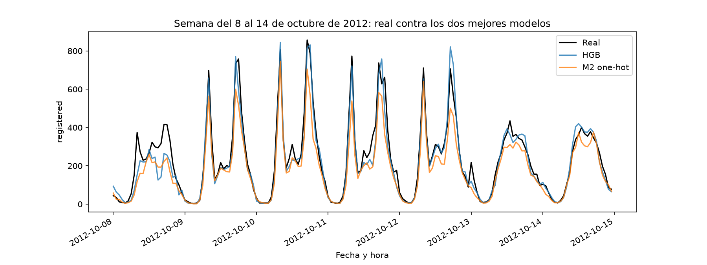
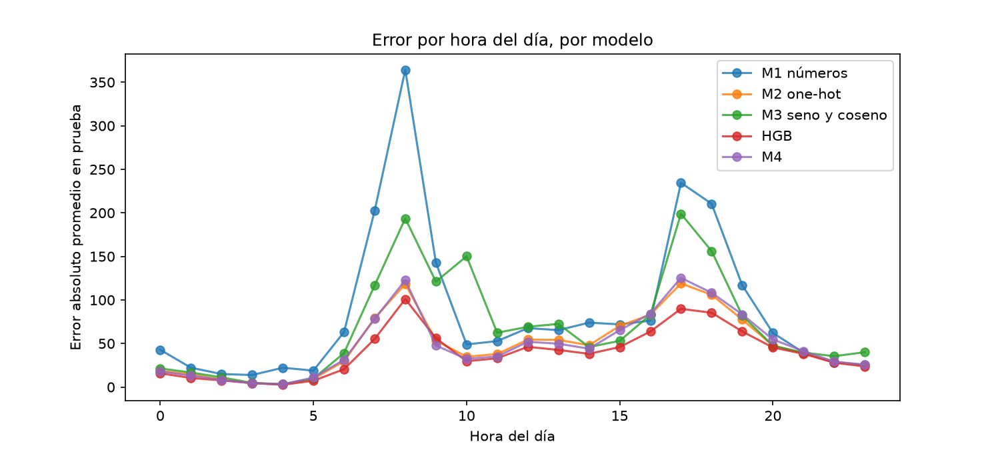

# Problema 2. Las 23:00 y la 01:00: kernels para el tiempo circular

- **Datos:** Bike Sharing Dataset (UCI), 17,379 horas de renta de bicicletas (2011-2012).
- **Objetivo:** como (a+b) mod 3 = 2, la variable a predecir es `registered`.
- **Candidatos de kernel:** $k_I(\theta,\theta')=e^{-d}$ (válido) y $k_{II}(\theta,\theta')=e^{-d^2/8}$ (no es kernel; ver teoría en el PDF).
- **Semilla:** 222214735.

## Cómo reproducir los resultados

Desde esta carpeta, con el entorno del README principal activado:

```bash
jupyter nbconvert --to notebook --execute --inplace problema-2.ipynb
```

La libreta descarga los datos en `data/`, tarda unos minutos (la búsqueda de M4 es la parte lenta, ~3-4 min) y guarda tablas y figuras en `resultados/`.

## Partición y validación

- Prueba: 1 de octubre al 31 de diciembre de 2012 (2,168 horas), apartada desde el inicio.
- Muestra para elegir hiperparámetros: 3,000 horas al azar del resto (15,211 horas), necesaria porque M4 entrena una SVR con kernel precomputado y una matriz de 15,211×15,211 es inviable.
- Validación: tres bloques consecutivos de 2012 (marzo-mayo, mayo-julio, julio-octubre), entrenando siempre con todo lo anterior. Se descarta `TimeSeriesSplit` porque sus primeros pliegues entrenarían solo con 2011 y nunca verían `yr=1`.

## Verificación numérica de la teoría (inciso b)

| Candidato | Menor valor propio (24 horas) | Menor valor propio (muestra) |
|---|---:|---:|
| k_I | 0.1245 | ≈0 (-1.69e-12, redondeo numérico) |
| k_II | -0.4418 | -56.28 |

Confirma, con los datos del examen, lo que se prueba en el PDF: `k_I` es un kernel válido y `k_II` no lo es.

## Modelos M1-M3 y referencia de boosting

| Modelo | Error de validación (MAE) | Error de prueba (MAE) |
|---|---:|---:|
| HGB (referencia) | 39.16 | **39.89** |
| M2 one-hot | 38.62 | 48.67 |
| M3 seno y coseno | 68.03 | 69.86 |
| M1 números | 88.42 | 86.88 |

Nota: M3 (la codificación circular "de libro") queda peor que M2 (one-hot) en este problema, pese a que one-hot no sabe que las horas son categorías circulares — ver la bitácora para la discusión.

## M4: kernel combinado

Mejor configuración encontrada (162 combinaciones × 3 bloques): `lam_h=0.5, lam_d=0.5, gamma=0.1, C=1, epsilon=0.05`, error de validación 48.20, error de prueba 48.81.

**Advertencia metodológica:** los 5 hiperparámetros quedaron en el valor más chico de su malla. Queda documentado como limitación en la bitácora, no resuelto en esta entrega, porque ampliar la malla después de ver el error de prueba habría sido una segunda selección de modelo.

### M4 con k_II (el candidato que no es kernel)

| kernel_hora | bloque | término cuadrático del dual | % coef. en C | predicción log1p |
|---|---:|---:|---:|---|
| k_I | 1-3 | 348 a 377 (positivo) | 62-65% | 1.1 a 6.6 (razonable) |
| k_II | 1-3 | -9,474 a -14,866 (**negativo**) | 97-98% | -3.7 a 22.2 (sin sentido) |

El solver no reporta ningún aviso (`fit_status_=0`), pero el término cuadrático del dual (que debe ser ‖w‖² ≥ 0 solo si el kernel es válido) se vuelve negativo con `k_II`: el problema deja de ser convexo sin que `scikit-learn` lo note. El error de validación con `k_II` se dispara a entre 57,650 y 13,259,780 bicicletas.

## Tabla final (inciso d)

| Modelo | Error de validación | Error de prueba |
|---|---:|---:|
| HGB | 39.16 | **39.89** |
| M2 one-hot | 38.62 | 48.67 |
| M4 | 48.20 | 48.81 |
| M3 seno y coseno | 68.03 | 69.86 |
| M1 números | 88.42 | 86.88 |
| M4 con k_II | 4,719,253 | 1.64×10¹¹ |





## ¿Valió la pena el kernel circular?

La comparación justa es **M4 contra M3**, no contra M1: por el inciso (b) de la teoría, M3 ya usa un kernel circular válido. M4 (48.81) le gana a M3 (69.86) por cerca de 30%, así que el kernel combinado particular de M4 sí aporta frente a la codificación circular más simple. Pero M4 no le gana a HGB (39.89) ni se distingue con claridad de M2 one-hot (48.67): el kernel circular a mano ayuda frente a la alternativa circular ingenua, no frente a todo.
